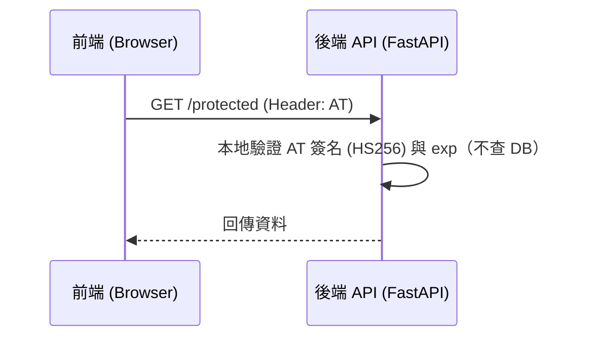
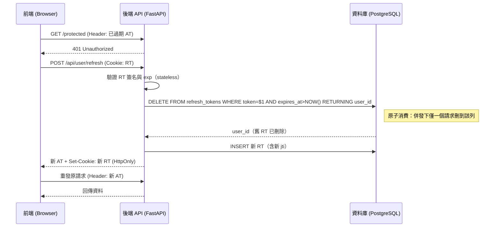
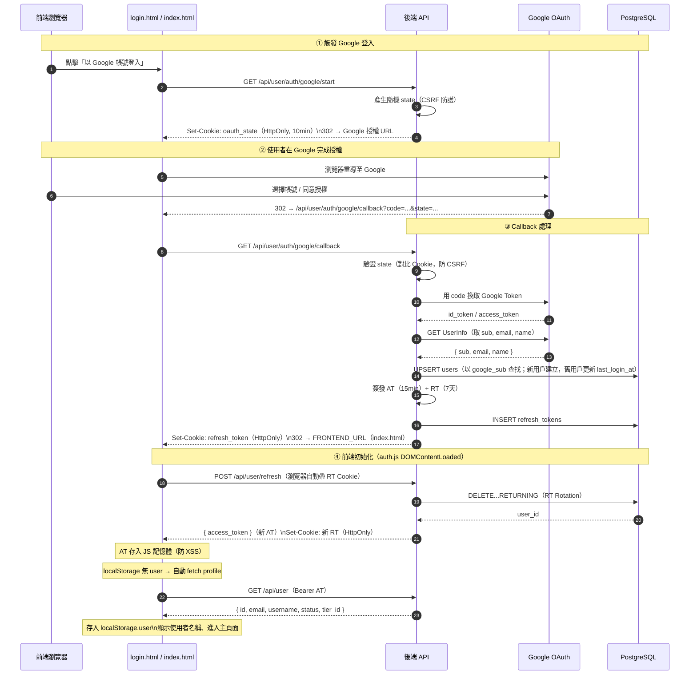

# 身份驗證與授權系統規格 (Auth System Specification)

## 1. 概述

本系統管理 Stock Insight Chat 的使用者帳戶。採用 **Google SSO（OAuth 2.0 / OIDC）** 作為唯一登入方式（**無本地密碼註冊/登入**），登入後由後端簽發自有 **JWT**（Access Token / Refresh Token）做後續 API 驗證。

Google SSO 端點與 `users` 表設計見 §6；前端換發流程見 §7。

## 2. 技術選型

- **登入方式**: Google SSO（OAuth 2.0 / OIDC），以 `google_sub` 為身分主鍵
- **驗證機制**: JWT（Header: `Authorization: Bearer <token>`），HS256 簽名
- **權杖策略**:
    - `access_token`: 效期 15 分鐘，存於前端 JS 記憶體變數，stateless 驗證（不查 DB）
    - `refresh_token`: 效期 7 天，存於 `HttpOnly` Cookie（`SameSite=Lax`），用於換發 AT
- **資料庫實體**: `users`、`refresh_tokens`、`subscription_tiers`

## 3. 流程詳細設計

### A. 登入流程 (Google SSO)

1. 前端點擊「以 Google 帳號登入」→ `GET /api/user/auth/google/start`（後端產生 `state` 存入 HttpOnly Cookie，302 導向 Google）。
2. 使用者在 Google 完成授權，Google 302 回 `GET /api/user/auth/google/callback`。
3. 後端驗 `state`（CSRF 防護）、用 `code` 換 Google Token、取 UserInfo（`sub`/`email`/`name`）。
4. 以 `google_sub` upsert `users`；新用戶建立並分配 `Free` 等級 `tier_id`，同時確保 `user_usage_quotas` 有列。
5. 簽發 AT（15 分鐘）+ RT（7 天），RT 寫入 `refresh_tokens` 並設為 HttpOnly Cookie，302 回前端。
6. 前端以 `POST /api/user/refresh` 換取第一個 AT，並 `GET /api/user` 取得 profile。

### B. 一般 API 請求（Stateless AT 驗證）



### C. AT 過期與 RT Rotation



若 `DELETE` 到 0 列但 RT 簽名仍有效，判定為 **Token Reuse Attack**，撤銷該用戶所有 session（`DELETE FROM refresh_tokens WHERE user_id=$1`）並回 401。

### D. 登出流程 (Logout)

1. 前端呼叫 `POST /api/user/logout`（Cookie 帶 RT）。
2. 後端 `DELETE FROM refresh_tokens WHERE token=$1`（僅刪目前這台裝置的 RT）。
3. 後端回傳 `Set-Cookie: refresh_token=; Max-Age=0` 清除 Cookie。

## 4. 各類情境處理 (Scenarios)

| 情境 | 系統反應 |
| :--- | :--- |
| **Access Token 被盜** | 最長 15 分鐘內可存取；無 RT 無法換發新 AT。 |
| **Refresh Token 被盜後被本人先使用** | 舊 RT 已被消費；盜用方持舊 RT refresh 時觸發 reuse 偵測，全 session 撤銷。 |
| **偵測到 Token Reuse** | 撤銷該用戶所有 RT，所有裝置需重新登入。 |
| **RT 過期 (7 天)** | `POST /refresh` 回 401，使用者需重新以 Google 登入。 |
| **多裝置** | 每次登入 INSERT 一筆獨立 RT；登出只刪自己那筆，其他裝置不受影響。 |

## 5. 安全性考量

- **AT 不落 localStorage**: 存於 JS 記憶體變數，降低 XSS 竊取風險；頁面刷新後由 RT 重新換發。
- **RT HttpOnly + SameSite=Lax**: JS 無法讀取（防 XSS），SameSite 降低 CSRF 風險；HTTPS 環境搭配 `COOKIE_SECURE=true`。
- **RT Rotation + Reuse 偵測**: 以 `DELETE ... RETURNING` 原子消費舊 RT，重放即撤銷全部 session。
- **OAuth state**: `state` 存 HttpOnly Cookie 並於 callback 比對，防 CSRF。
- **UUID 主鍵**: 使用者與 Token ID 均為 UUID，避免 ID 遍歷。

---

## 6. Google SSO 實作細節

（原 `google_sso.md`；舊資料庫升級用的 migration SQL 已套用完畢，不再保留）

### 1. 為何以 `google_sub` 為身分主鍵？

Google 使用 **OpenID Connect**，登入後的 ID Token / UserInfo 含：

| 欄位 | Google 名稱 | 意義 |
|------|-------------|------|
| **主體識別碼** | `sub`（Subject） | Google 帳號的**唯一穩定 ID**。改暱稱、改 email 都不會變。存為 `users.google_sub`。 |
| 聯絡用 | `email` | 可能被使用者更改；不能作為身分主鍵，只做顯示用。 |

---

### 2. Users 表設計（Google-Only）

```sql
CREATE TABLE IF NOT EXISTS users (
    id UUID PRIMARY KEY DEFAULT gen_random_uuid(),
    email VARCHAR(255) UNIQUE NOT NULL,
    username VARCHAR(100) UNIQUE NOT NULL,
    google_sub TEXT UNIQUE NOT NULL,       -- Google OIDC subject，必填
    last_login_provider VARCHAR(32) DEFAULT 'google',
    status VARCHAR(20) DEFAULT 'active',
    tier_id UUID REFERENCES subscription_tiers(id) ON DELETE SET NULL,
    last_login_at TIMESTAMPTZ,
    created_at TIMESTAMPTZ DEFAULT CURRENT_TIMESTAMP,
    updated_at TIMESTAMPTZ DEFAULT CURRENT_TIMESTAMP
);
```

移除的欄位（相較舊雙模式 schema）：
- `password_hash`：不再支援本地密碼
- `email_verified`：Google 已驗證信箱，欄位無意義
- `CONSTRAINT users_has_password_or_google`：不再需要

---

### 3. OAuth 端點設計

#### `GET /api/user/auth/google/start`
- 產生隨機 `state`，存入 HttpOnly Cookie（10 分鐘有效）
- 302 重導到 Google 授權 URL

#### `GET /api/user/auth/google/callback`（Google Console 登記的 Redirect URI）
- 驗 `state`（CSRF 防護）
- 用 `code` 換 Google Access Token
- 呼叫 Google UserInfo API 取 `sub`、`email`、`name`
- Upsert `users`（以 `google_sub` 查找）
- 簽發自有 JWT AT + RT，設定 HttpOnly Cookie
- 302 重導回前端（前端用 `POST /api/user/refresh` 換 AT）

---

### 5. Google Cloud Console 設定

| 欄位 | 值 |
|------|----|
| **Authorized JavaScript origins** | `http://localhost`（開發）、`https://yourdomain.com`（正式） |
| **Authorized redirect URIs** | `http://localhost:8000/api/user/auth/google/callback` |

> Redirect URI 必須與 `GOOGLE_OAUTH_REDIRECT_URI` 環境變數**完全一致**（含 port、path、protocol）。

---

### 6. 相關環境變數（`.env`）

```dotenv
GOOGLE_CLIENT_ID=xxx.apps.googleusercontent.com
GOOGLE_CLIENT_SECRET=GOCSPX-...
GOOGLE_OAUTH_REDIRECT_URI=http://localhost:8000/api/user/auth/google/callback
FRONTEND_URL=http://localhost
COOKIE_SECURE=false   # 開發環境；正式 HTTPS 環境改為 true
```

---

### 7. 完整登入流程（前端 → 後端 → 前端）



#### 步驟說明

| 步驟 | 說明 |
|------|------|
| ① 觸發 | `login.html` 點擊按鈕 → `GET /api/user/auth/google/start` → 後端設 `oauth_state` Cookie → 302 至 Google |
| ② Google 授權 | 使用者在 Google 選擇帳號並同意授權 → Google 302 回後端 Callback URI |
| ③ Callback | 後端驗 state、換取 Token、Upsert 用戶、設 RT Cookie → 302 回前端首頁 |
| ④ 前端初始化 | `auth.js` DOMContentLoaded 執行 `tryRefreshToken()` → 取得 AT → 若 localStorage 無 user 則 fetch `/api/user` profile |

---

### 8. 相關檔案

| 檔案 | 說明 |
|------|------|
| `app/backend/api/auth.py` | Google SSO 端點實作（start / callback / logout / refresh） |
| `app/backend/database/init_db.sql` | 新環境的 `users` 表定義（Google-only） |
| `app/frontend/html/login.html` | Google SSO 登入頁面（僅單一 Google 按鈕） |
| `app/frontend/js/login.js` | 登入頁邏輯（OAuth redirect + 錯誤代碼處理） |
| `app/frontend/js/auth.js` | Token 管理、首次登入 profile fetch、三重 RT 換發機制 |
| `specifications/api_spec.md` | 完整 API 端點規格 |

---

## 7. 前端換發 Token 三機制

（原 `readme_full_details.md`）

為確保用戶在發送聊天時不因 Token 驗證而感受到等待，前端實作三重機制：

```
機制 A（主要路徑）─────────────────────────────────────────────────
 取得新 AT 後立即計算 exp - 60s
 → 設定 setTimeout(_silentRefresh, delay)
 → Timer 到期時在背景靜默呼叫 /refresh
 → 取得新 AT 存入記憶體，並重設下一輪 Timer
 → 用戶發聊天時 AT 已是新的，零等待

機制 B（Fallback）──────────────────────────────────────────────────
 authFetch 每次發請求前檢查 AT 剩餘秒數：
   ├─ exp - now ≤ 90s → 先呼叫 tryRefreshToken()，換完再發
   └─ 若 API 回傳 401（Timer 延遲未及換） → tryRefreshToken() → 重送請求
 瀏覽器分頁在背景被節流時 Timer 可能延誤，機制 B 作為補位防線

機制 C（並發鎖）────────────────────────────────────────────────────
 _isRefreshing flag + _refreshPromise 共用同一個 Promise
   ├─ 第一個觸發 /refresh 的請求：設 _isRefreshing = true，執行並記下 Promise
   └─ 同時間其他請求：等待同一個 Promise，共用換 Token 結果

 ⚠️ 無此鎖的風險：
   兩個並發 401 → 同時呼叫 /refresh（兩次）
   → 第一次：RT 旋轉成功，DB 舊 RT 被刪
   → 第二次：拿著已被消費的舊 RT → 後端判定 Reuse Attack
   → 後端撤銷所有 Session → 用戶被強制登出所有裝置
```

| 機制 | 實作位置 | 觸發條件 | 用戶感知 |
| :--- | :--- | :--- | :--- |
| A 主動 Timer | `_scheduleProactiveRefresh()` | AT exp - 60s | 無感知（背景執行） |
| B Request Interceptor | `authFetch()` | exp ≤ 90s 或收到 401 | 輕微等待（~200ms） |
| C 並發鎖 | `tryRefreshToken()` | 多個請求同時觸發 | 無影響（共用結果） |

---
